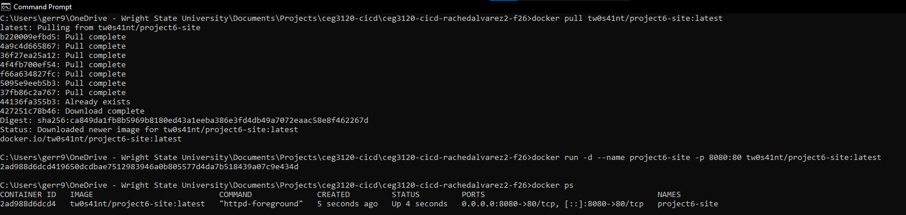
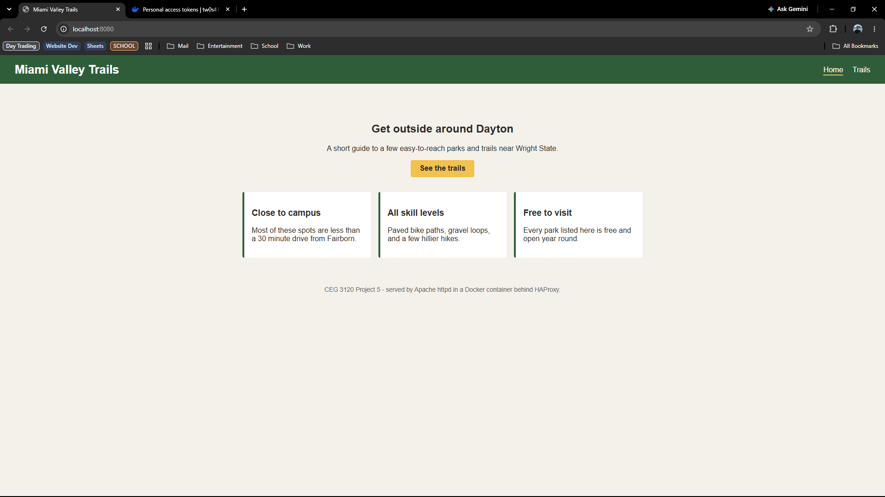
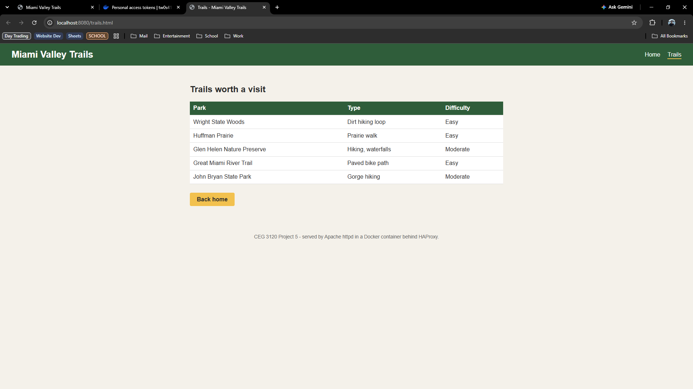
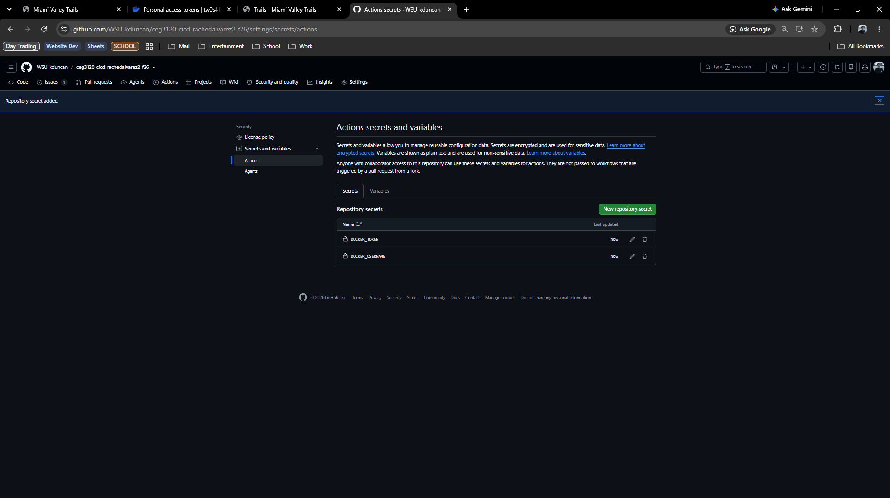
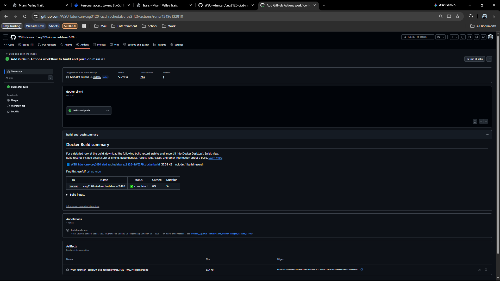
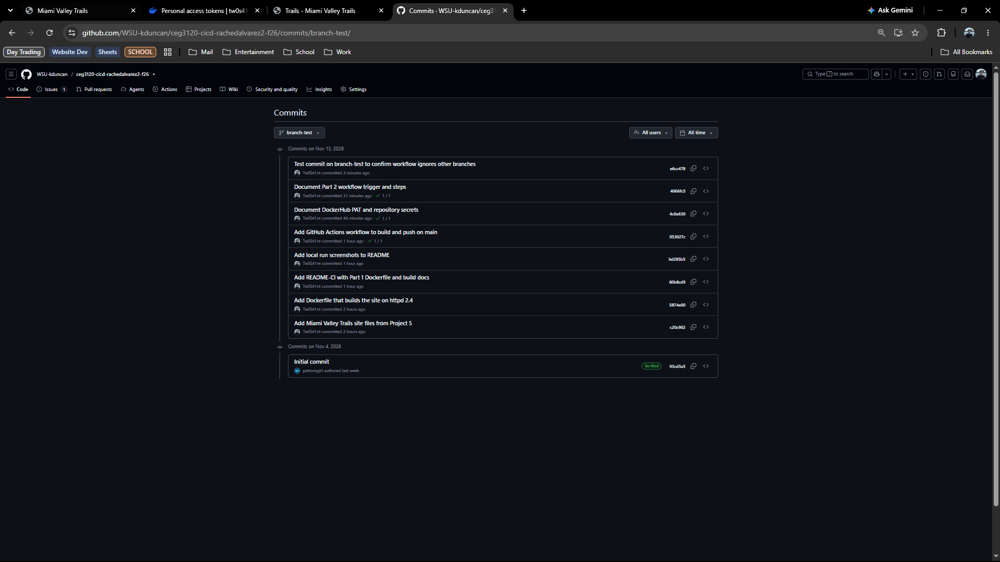
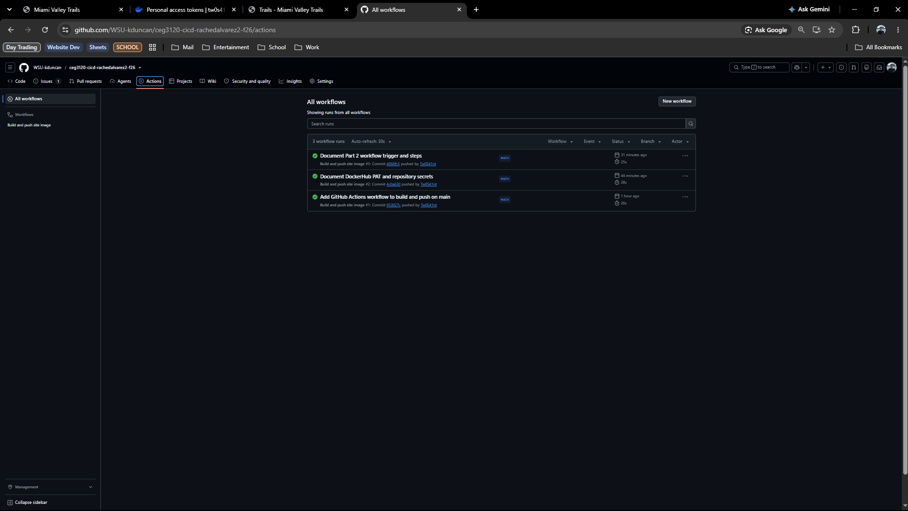
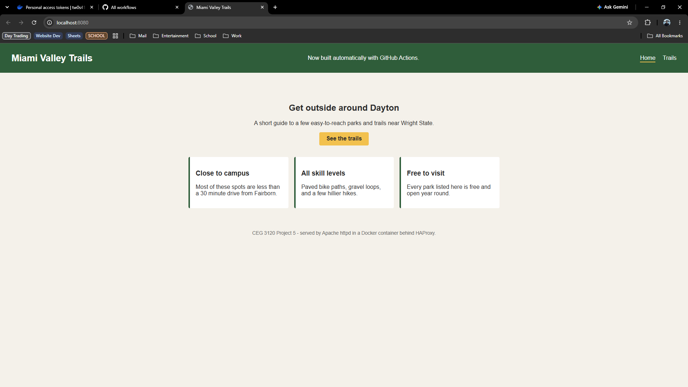

# Project 6 - Continuous Integration

## Part 1 - Dockerfile & Building Images

### Web site content

I reused the Miami Valley Trails site from Project 5. The files are in [`web-content/`](web-content/):

- [`index.html`](web-content/index.html) - the home page with a short intro and three info cards
- [`trails.html`](web-content/trails.html) - a table of trails around Dayton
- [`style.css`](web-content/style.css) - colors, nav bar, cards, and table styling shared by both pages

### Dockerfile

The [`Dockerfile`](Dockerfile) is in the root of the repo:

```dockerfile
FROM httpd:2.4
COPY web-content/ /usr/local/apache2/htdocs/
```

`FROM httpd:2.4` starts from the official Apache image, which already serves pages on port 80. The `COPY` line puts everything in `web-content/` into `/usr/local/apache2/htdocs/`, the folder Apache serves by default. Since `index.html` lands there, it's what you get at `/`.

In Project 5 the Dockerfile sat inside `web-content/` and used `COPY . ...`. I moved it to the repo root for this project, because GitHub Actions builds from the root of the repo.

### Building the image

From the root of the repo:

```bash
docker build -t tw0s41nt/project6-site:latest .
```

### Pushing to DockerHub

```bash
# Log in with a DockerHub Personal Access Token (paste it at the password prompt)
docker login -u tw0s41nt

docker push tw0s41nt/project6-site:latest
```

The repository gets created on DockerHub the first time you push. Check that it's set to **Public**.

### Running a container from the image

```bash
docker pull tw0s41nt/project6-site:latest
docker run -d --name project6-site -p 8080:80 tw0s41nt/project6-site:latest
```

- `-d` runs it in the background.
- `-p 8080:80` maps port 8080 on my machine to port 80 in the container, where Apache listens.

Then open `http://localhost:8080` and `http://localhost:8080/trails.html` in a browser. To stop and remove it: `docker rm -f project6-site`.


## Part 2 - GitHub Actions and DockerHub

### Creating a DockerHub PAT for GitHub Actions

I made a separate token for GitHub Actions instead of reusing the one from my laptop, so I can revoke one without breaking the other.

1. Sign in at https://hub.docker.com and go to **Account settings > Personal access tokens**.
2. Click **Generate new token**. I named it `github-actions-project6`.
3. Set **Access permissions** to **Read & Write**.
4. Click **Generate** and copy the token right away.

### Setting repository secrets

1. In the GitHub repo, go to **Settings > Secrets and variables > Actions**.
2. Click **New repository secret**.
3. Enter the name and value and click **Add secret**. Do it once for each secret.

After a secret is saved, GitHub won't show its value again.

| Secret | What it holds | Used for |
| --- | --- | --- |
| `DOCKER_USERNAME` | My DockerHub username | Logging in to DockerHub, and as the first part of the image name |
| `DOCKER_TOKEN` | The Read & Write PAT from above | The password for `docker/login-action` |

The token only lives in GitHub secrets. It's never in any file in this repo.

### CI with GitHub Actions

Part 2 version of the workflow (commit permalink): [docker-ci.yml at 053027c](https://github.com/WSU-kduncan/ceg3120-cicd-rachedalvarez2-f26/blob/053027cadb5e16f6292e6378b686aa991f719ad7/.github/workflows/docker-ci.yml)

#### Trigger

```yaml
on:
  push:
    branches:
      - main
```

The workflow ran when a commit was pushed to `main`.

#### Steps

| Step | Action | What it does |
| --- | --- | --- |
| Check out the repository | `actions/checkout@v7` | Copies the repo onto the runner so the build can see the `Dockerfile` and `web-content/` |
| Log in to DockerHub | `docker/login-action@v4` | Logs in using the `DOCKER_USERNAME` and `DOCKER_TOKEN` secrets |
| Set up Docker Buildx | `docker/setup-buildx-action@v4` | Sets up the Buildx builder that `build-push-action` uses |
| Build and push the image | `docker/build-push-action@v7` | Builds from the `Dockerfile` in the repo root (`context: .`) and pushes `<username>/project6-site:latest` |

All four come from GitHub (`actions`) or Docker (`docker`).

#### Changes needed to use this in a different repository

In the workflow:

- `tags: ${{ secrets.DOCKER_USERNAME }}/project6-site:latest` - change `project6-site` to your DockerHub repository name.
- `branches: - main` - change it if your default branch is named something else.

In the repository:

- Create the `DOCKER_USERNAME` and `DOCKER_TOKEN` secrets with your own DockerHub username and a Read & Write PAT.
- Keep the `Dockerfile` in the repo root and the site in `web-content/`, or update `context:` and the `COPY` line to match.
- Put the workflow file in `.github/workflows/`.

### Testing & Validating (Part 2)

**Checking that the workflow worked:**

1. Push a commit to `main`.
2. Open the repo's **Actions** tab. A run should show up for that commit.
3. Click the run and the `build-and-push` job. Every step should have a green check, and the build step's log ends with the image being pushed.
4. On DockerHub, the `latest` tag's "Last pushed" time should match when the run finished.

**Checking that the image works:**

```bash
docker pull tw0s41nt/project6-site:latest
docker run -d --name project6-site -p 8080:80 tw0s41nt/project6-site:latest
```

Then open `http://localhost:8080` and make sure the newest change to the site is there. If `docker pull` says the image is up to date, you're still on the old one locally, so remove it with `docker rm -f project6-site` and `docker image rm tw0s41nt/project6-site:latest`, then pull again.

**DockerHub repository:** https://hub.docker.com/r/tw0s41nt/project6-site

## Testing and Proof

### 1. Local run



`docker ps` shows `tw0s41nt/project6-site:latest` running with `0.0.0.0:8080->80/tcp`, the image I built and pulled works.





Both `index.html` and `trails.html` load at `localhost:8080` with the CSS applied.


### 2. Repository secrets



The repo's Actions secrets page lists `DOCKER_USERNAME` and `DOCKER_TOKEN`. GitHub doesn't show the values.


### 3. Main trigger



A successful run that started from a push to `main`, with commit SHA `053027c` showing.


### 4. Branch negative test



I pushed commit `e6cc478` to a branch called `branch-test`. It shows up on that branch, and it has no check mark next to it, while the `main` commits do.



The Actions tab only lists runs from `main`. Nothing ran for the `branch-test` commit, so the workflow really only runs for `main`.

### 5. Change to image



I added "Now built automatically with GitHub Actions." to the home page and pushed it to `main`. After run #4 finished, I pulled the new `latest` image, ran it, and the browser shows the new line.