# Project 6 - Continuous Integration

## Part 1 - Dockerfile & Building Images

### Web site content

I reused the Miami Valley Trails site from Project 5. The files are in [`web-content/`](web-content/):

- [`index.html`](web-content/index.html) - the home page with a short intro and three info cards
- [`trails.html`](web-content/trails.html) - a table of trails around Dayton
- [`style.css`](web-content/style.css) - colors, nav bar, cards, and table styling shared by both pages

### Dockerfile

The [`Dockerfile`](Dockerfile) is in the root of the repo:

```dockerfile
FROM httpd:2.4
COPY web-content/ /usr/local/apache2/htdocs/
```

`FROM httpd:2.4` starts from the official Apache image, which already serves pages on port 80. The `COPY` line puts everything in `web-content/` into `/usr/local/apache2/htdocs/`, the folder Apache serves by default. Since `index.html` lands there, it's what you get at `/`.

In Project 5 the Dockerfile sat inside `web-content/` and used `COPY . ...`. I moved it to the repo root for this project, because GitHub Actions builds from the root of the repo.

### Building the image

From the root of the repo:

```bash
docker build -t tw0s41nt/project6-site:latest .
```

**Tagging for DockerHub:** to push to DockerHub, the image name has to be `<dockerhub-username>/<repository>:<tag>`, so mine is `tw0s41nt/project6-site:latest`. If the name doesn't start with your username, `docker push` tries to push to an official library repo and gets denied. If you leave off `:<tag>`, Docker uses `latest`.

### Pushing to DockerHub

```bash
# Log in with a DockerHub Personal Access Token (paste it at the password prompt)
docker login -u tw0s41nt

docker push tw0s41nt/project6-site:latest
```

The repository gets created on DockerHub the first time you push. Check that it's set to **Public**.

### Running a container from the image

```bash
docker pull tw0s41nt/project6-site:latest
docker run -d --name project6-site -p 8080:80 tw0s41nt/project6-site:latest
```

- `-d` runs it in the background.
- `-p 8080:80` maps port 8080 on my machine to port 80 in the container, where Apache listens.

Then open `http://localhost:8080` and `http://localhost:8080/trails.html` in a browser. To stop and remove it: `docker rm -f project6-site`.


## Part 2 - GitHub Actions and DockerHub

### Creating a DockerHub PAT for GitHub Actions

I made a separate token for GitHub Actions instead of reusing the one from my laptop, so I can revoke one without breaking the other.

1. Sign in at https://hub.docker.com and go to **Account settings > Personal access tokens**.
2. Click **Generate new token**. I named it `github-actions-project6`.
3. Set **Access permissions** to **Read & Write**.
4. Click **Generate** and copy the token right away.

### Setting repository secrets

1. In the GitHub repo, go to **Settings > Secrets and variables > Actions**.
2. Click **New repository secret**.
3. Enter the name and value and click **Add secret**. Do it once for each secret.

After a secret is saved, GitHub won't show its value again.

| Secret | What it holds | Used for |
| --- | --- | --- |
| `DOCKER_USERNAME` | My DockerHub username | Logging in to DockerHub, and as the first part of the image name |
| `DOCKER_TOKEN` | The Read & Write PAT from above | The password for `docker/login-action` |

The token only lives in GitHub secrets. It's never in any file in this repo.

### CI with GitHub Actions

Part 2 version of the workflow (commit permalink): [docker-ci.yml at 053027c](https://github.com/WSU-kduncan/ceg3120-cicd-rachedalvarez2-f26/blob/053027cadb5e16f6292e6378b686aa991f719ad7/.github/workflows/docker-ci.yml)

#### Trigger

```yaml
on:
  push:
    branches:
      - main
```

The workflow ran when a commit was pushed to `main`.

#### Steps

| Step | Action | What it does |
| --- | --- | --- |
| Check out the repository | `actions/checkout@v7` | Copies the repo onto the runner so the build can see the `Dockerfile` and `web-content/` |
| Log in to DockerHub | `docker/login-action@v4` | Logs in using the `DOCKER_USERNAME` and `DOCKER_TOKEN` secrets |
| Set up Docker Buildx | `docker/setup-buildx-action@v4` | Sets up the Buildx builder that `build-push-action` uses |
| Build and push the image | `docker/build-push-action@v7` | Builds from the `Dockerfile` in the repo root (`context: .`) and pushes `<username>/project6-site:latest` |

All four come from GitHub (`actions`) or Docker (`docker`).

#### Changes needed to use this in a different repository

In the workflow:

- `tags: ${{ secrets.DOCKER_USERNAME }}/project6-site:latest` - change `project6-site` to your DockerHub repository name.
- `branches: - main` - change it if your default branch is named something else.

In the repository:

- Create the `DOCKER_USERNAME` and `DOCKER_TOKEN` secrets with your own DockerHub username and a Read & Write PAT.
- Keep the `Dockerfile` in the repo root and the site in `web-content/`, or update `context:` and the `COPY` line to match.
- Put the workflow file in `.github/workflows/`.

### Testing & Validating (Part 2)

**Checking that the workflow worked:**

1. Push a commit to `main`.
2. Open the repo's **Actions** tab. A run should show up for that commit.
3. Click the run and the `build-and-push` job. Every step should have a green check, and the build step's log ends with the image being pushed.
4. On DockerHub, the `latest` tag's "Last pushed" time should match when the run finished.

**Checking that the image works:**

```bash
docker pull tw0s41nt/project6-site:latest
docker run -d --name project6-site -p 8080:80 tw0s41nt/project6-site:latest
```

Then open `http://localhost:8080` and make sure the newest change to the site is there. If `docker pull` says the image is up to date, you're still on the old one locally, so remove it with `docker rm -f project6-site` and `docker image rm tw0s41nt/project6-site:latest`, then pull again.

**DockerHub repository:** https://hub.docker.com/r/tw0s41nt/project6-site

## Part 3 - Semantic Versioning

### Generating tags

```bash
# See all tags in the repo
git tag -l

# See tags along with their messages
git tag -n

# Create an annotated tag on the latest commit
git tag -a v1.0.0 -m "First release of the trails site"

# Push one tag to GitHub (a normal git push doesn't send tags)
git push origin v1.0.0
```

I used `MAJOR.MINOR.PATCH`:

- **MAJOR** for big changes that break how the site works or looks.
- **MINOR** for new content or features, like adding a page or a section.
- **PATCH** for small fixes, like a typo.

### Semantic Versioning Container Images with GitHub Actions

Workflow file: [`.github/workflows/docker-ci.yml`](.github/workflows/docker-ci.yml)

#### Trigger

```yaml
on:
  push:
    tags:
      - 'v*.*.*'
```

The workflow only runs when a tag that looks like `v1.1.0` is pushed. I removed the `branches: - main` trigger, so ordinary commits to `main` don't build anything anymore.

#### Steps

| Step | Action | What it does |
| --- | --- | --- |
| Check out the repository | `actions/checkout@v7` | Copies the repo at the tagged commit onto the runner |
| Generate image tags from the git tag | `docker/metadata-action@v6` | Reads the git tag and outputs the image tags. For `v1.1.0` it outputs `project6-site:1`, `project6-site:1.1`, and `project6-site:latest` |
| Log in to DockerHub | `docker/login-action@v4` | Logs in with the `DOCKER_USERNAME` and `DOCKER_TOKEN` secrets |
| Set up Docker Buildx | `docker/setup-buildx-action@v4` | Sets up the builder |
| Build and push the image | `docker/build-push-action@v7` | Builds from the `Dockerfile` and pushes with every tag from the metadata step (`tags: ${{ steps.meta.outputs.tags }}`) |

The metadata step's settings:

```yaml
images: ${{ secrets.DOCKER_USERNAME }}/project6-site
tags: |
  type=semver,pattern={{major}}
  type=semver,pattern={{major}}.{{minor}}
```

`type=semver` reads the version from the git tag, and `pattern` picks which parts to keep. I didn't have to add `latest` myself, because `metadata-action` adds it automatically when the tag is a semver version.

#### Changes needed to use this in a different repository

In the workflow:

- `images: ${{ secrets.DOCKER_USERNAME }}/project6-site` - change `project6-site` to your DockerHub repository name.
- `- 'v*.*.*'` - change the pattern if your tags don't start with `v`.

In the repository:

- Same as Part 2: the `DOCKER_USERNAME` and `DOCKER_TOKEN` secrets, the `Dockerfile` in the root, and the workflow in `.github/workflows/`.
- Tag releases as `vMAJOR.MINOR.PATCH` and push the tag with `git push origin <tag>`.

### Testing & Validating (Part 3)

**Checking that the workflow worked:**

1. Create and push a tag: `git tag -a v1.1.0 -m "..."` then `git push origin v1.1.0`.
2. In the **Actions** tab, the new run should be labeled with the tag (`v1.1.0`) instead of a branch name.
3. Every step should have a green check. The log for the metadata step lists the tags it generated.
4. On DockerHub, the **Tags** tab should show `latest`, `1`, and `1.1`, all pushed at the same time.

**Checking that the image works:**

```bash
docker run -d --name site-1-0 -p 8080:80 tw0s41nt/project6-site:1.0
docker run -d --name site-1-1 -p 8081:80 tw0s41nt/project6-site:1.1
```

`http://localhost:8081` should show version 1.1 of the site, and `http://localhost:8080` should still show version 1.0. On DockerHub, `1.1`, `1`, and `latest` should all have the same digest, and `1.0` should have a different one.

**DockerHub repository with tags:** https://hub.docker.com/r/tw0s41nt/project6-site/tags

### Goal

The goal of this project was to stop building and pushing my website's Docker image by hand. In Project 5 I ran `docker build` and `docker push` every time. In this project I set up GitHub Actions so that GitHub builds the image and pushes it to DockerHub for me.

It happened in two stages:

1. **Part 2:** every push to `main` built a new image and pushed it as `latest`.
2. **Part 3:** only pushing a git tag like `v1.1.0` starts a build, and the image gets pushed with three tags: `latest`, the major version (`1`), and the major.minor version (`1.1`). Old versions stay on DockerHub, so I can roll back to them.

### Tools and their roles

| Tool | Role in this project |
| --- | --- |
| Git | Tracks my changes locally. Tags (`v1.0.0`, `v1.1.0`) mark which commits are releases |
| GitHub | Hosts the repository and stores the DockerHub login as repository secrets |
| GitHub Actions | Runs the workflow in [`.github/workflows/docker-ci.yml`](.github/workflows/docker-ci.yml) that builds and pushes the image |
| Docker | Builds the image from the [`Dockerfile`](Dockerfile) and runs containers to test it |
| `httpd:2.4` | Official Apache image that my site image is built on |
| DockerHub | Public container registry that stores my image and all its tags |
| `docker/metadata-action` | Turns a git tag like `v1.1.0` into the image tags `latest`, `1`, and `1.1` |
| `docker/login-action`, `docker/setup-buildx-action`, `docker/build-push-action` | Log in to DockerHub, set up the builder, and build and push the image |

### Diagram

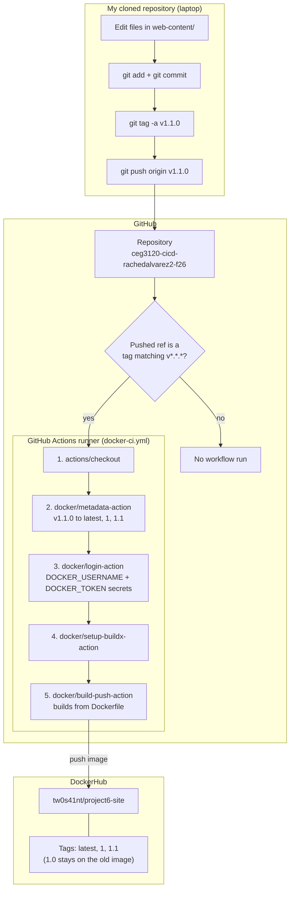

When I push a tag, GitHub checks whether it matches `v*.*.*`. If it does, a runner checks out the code at that tag, works out the image tags, logs in to DockerHub with the repository secrets, builds the image from the `Dockerfile`, and pushes it. A plain commit with no tag goes to GitHub but doesn't start anything.

## Testing and Proof

### 1. Local run

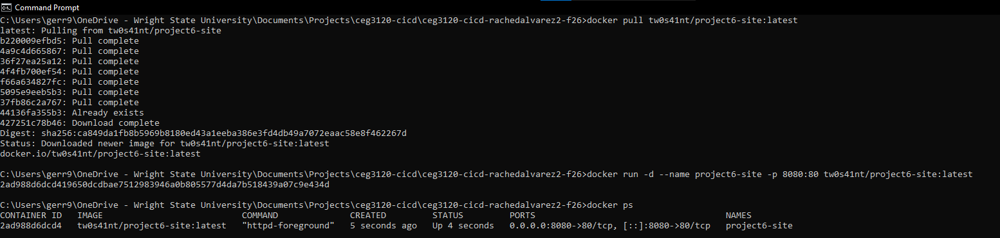

`docker ps` shows `tw0s41nt/project6-site:latest` running with `0.0.0.0:8080->80/tcp`, the image I built and pulled works.

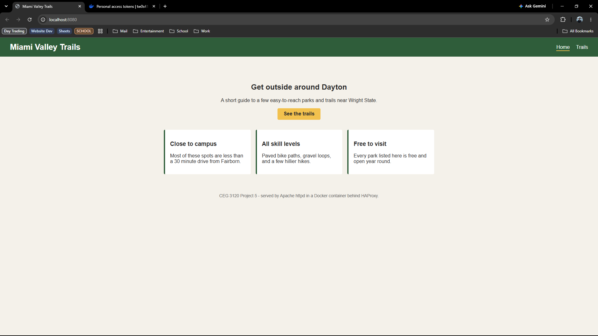

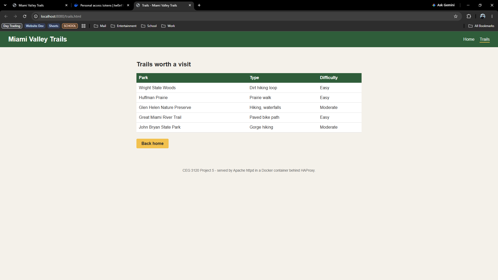

Both `index.html` and `trails.html` load at `localhost:8080` with the CSS applied.


### 2. Repository secrets

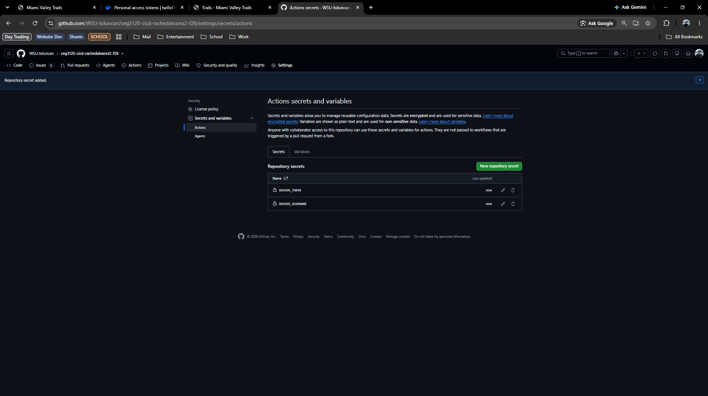

The repo's Actions secrets page lists `DOCKER_USERNAME` and `DOCKER_TOKEN`. GitHub doesn't show the values.


### 3. Main trigger

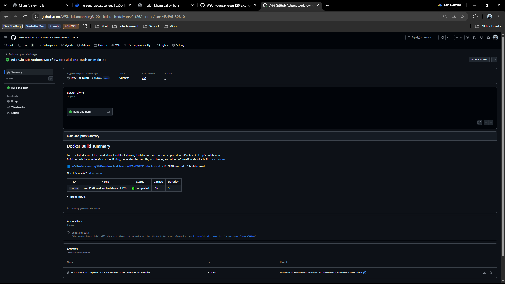

A successful run that started from a push to `main`, with commit SHA `053027c` showing.


### 4. Branch negative test

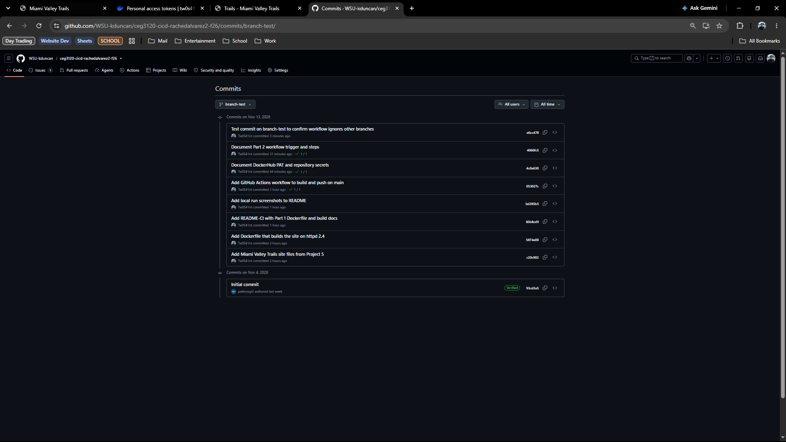

I pushed commit `e6cc478` to a branch called `branch-test`. It shows up on that branch, and it has no check mark next to it, while the `main` commits do.

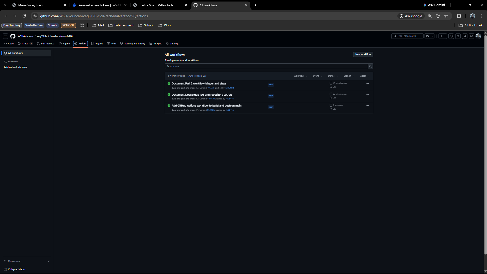

The Actions tab only lists runs from `main`. Nothing ran for the `branch-test` commit, so the workflow really only runs for `main`.

### 5. Change to image

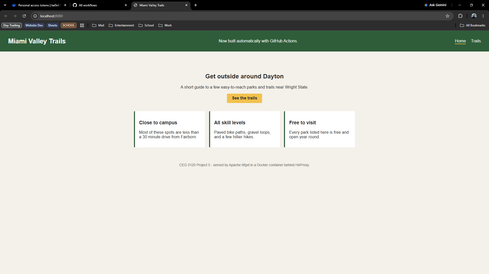

I added "Now built automatically with GitHub Actions." to the home page and pushed it to `main`. After run #4 finished, I pulled the new `latest` image, ran it, and the browser shows the new line.


### 6. Tag trigger

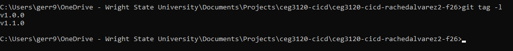

`git tag -l` lists my two tags, `v1.0.0` and `v1.1.0`.

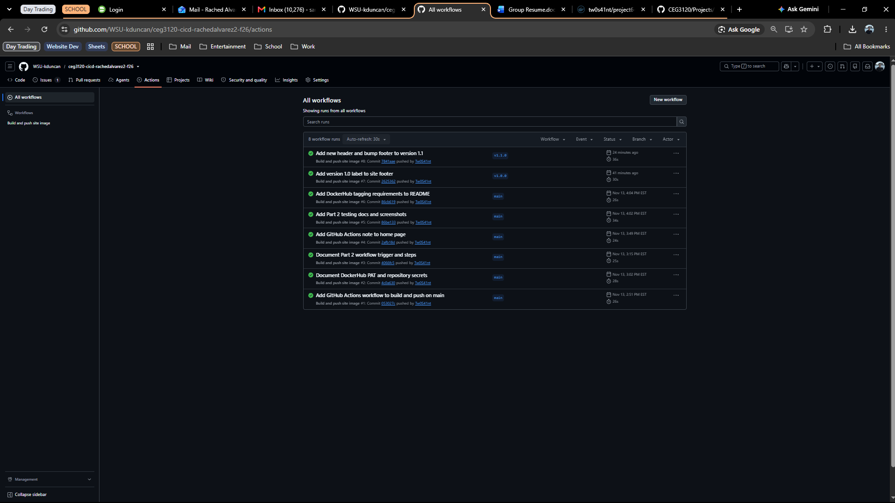

The Actions tab shows a successful run labeled `v1.1.0` instead of `main`, so pushing the tag is what started it.

### 7. Tag negative test

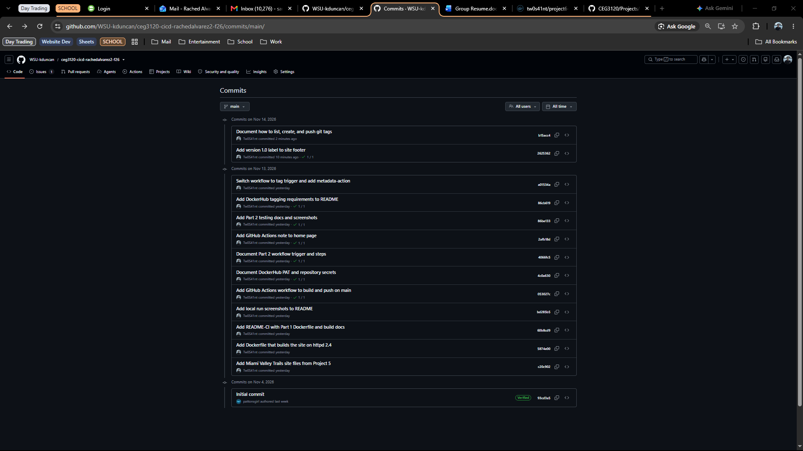

I pushed commit `b15acc4` to `main` without a tag. It shows up on GitHub with no check mark. The workflow-switch commit `a01534a` has no check mark either.

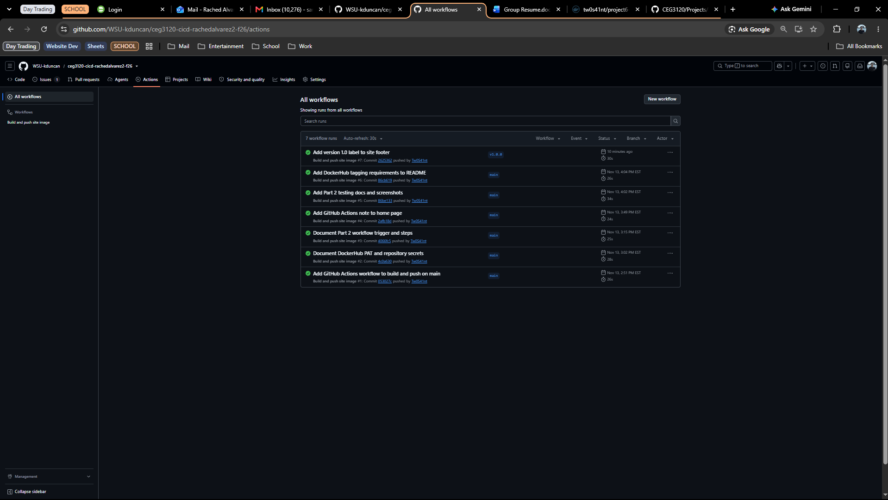

The newest run is the one for `v1.0.0`. Nothing ran for `b15acc4`, so the Part 3 workflow only runs on tags.

### 8. Tag set

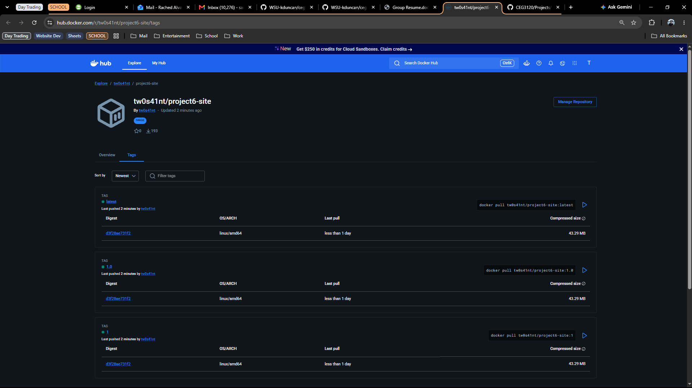

After pushing `v1.0.0`, DockerHub has `latest`, `1`, and `1.0`, all pushed by the GitHub Action and all on the same digest (`d3f28ae731f2`).

### 9. Two releases

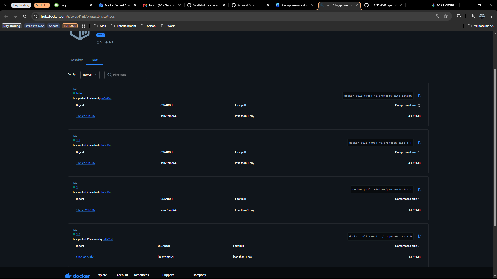

After releasing `v1.1.0`, `latest`, `1`, and `1.1` all share a new digest, while `1.0` still has `d3f28ae731f2`. A new release moves `latest` and the major tag forward, but it doesn't overwrite the old release.

### 10. Rollback

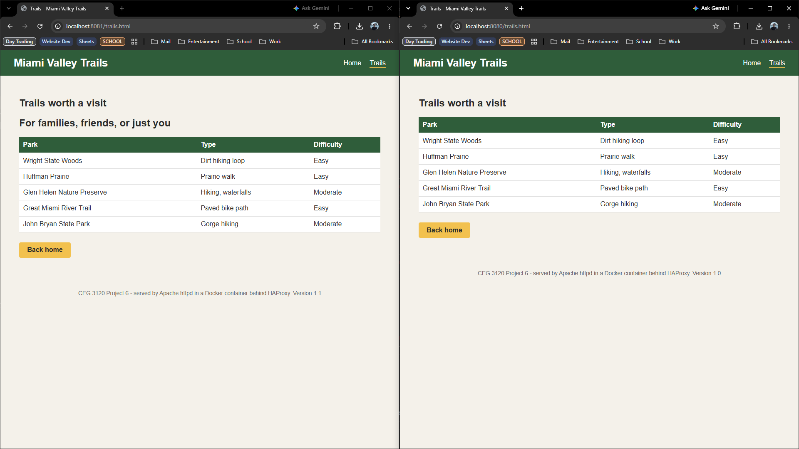

I ran one container from `:1.0` on port 8080 and one from `:1.1` on port 8081. Port 8081 shows the version 1.1 footer and the new "For families, friends, or just you" heading on the trails page. Port 8080 still shows version 1.0 without that heading, so I can roll back to 1.0 at any time.

## Sources

| Source | What I used it for |
| --- | --- |
| [GitHub - actions/checkout](https://github.com/actions/checkout) | Checking out the repo, current version (v7) |
| [Git - Tagging](https://git-scm.com/book/en/v2/Git-Basics-Tagging) | `git tag -l`, annotated tags, and pushing tags |
| [Semantic Versioning 2.0.0](https://semver.org/) | What MAJOR, MINOR, and PATCH mean |
| [Mermaid - Flowchart syntax](https://mermaid.js.org/syntax/flowchart.html) | Building the diagram with subgraphs |

### Generative AI

- **Website:** the Miami Valley Trails site is from Project 5, where AI picked the theme (see that project's citations).
- **AI:** I gave it the Project 6 instructions, the rubric, and my read me for styling purposes.